<div align="center">

# REVERSEAI

**AI agents that rebuild a web application from its observable behavior — clean-room, with an audit trail.**

**English** · [Русский](README.ru.md)


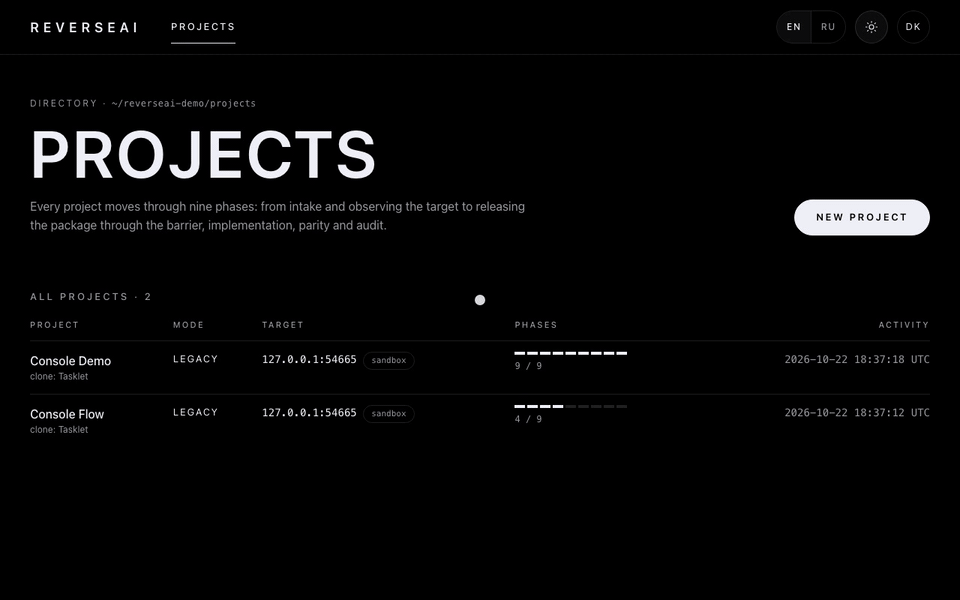

<sub>The console on the bundled demo target: prepare a release, review the sanitized spec and scenarios, approve by hash, check parity and costs.</sub>

</div>

---

ReverseAI is a research prototype of a **clean-room reimplementation pipeline**. It watches a running web application as a black box — browser sessions, HTTP traffic, API probing — turns what it saw into executable behavior scenarios and a behavioral specification, passes that specification through a human-approved **barrier**, and lets LLM agents write an independent clone that **never sees the original**. The clone is then checked against the original scenario by scenario, and every step is recorded in a hash-chained ledger that ends up in an **evidence pack**.

> **Status:** finished research prototype, published as open source under the [MIT license](LICENSE). It is not actively developed. It has been exercised end to end on a bundled demo target with a scripted LLM; it has not been run against real third-party products.

## Why

Coding agents can now rewrite large applications in days. The hard part is no longer generating code — it is proving two things:

1. **The clone behaves like the original** — measured on HTTP behavior and data, not on looks or a checklist of menu items.
2. **The clone is independent** — the agents that wrote it never had access to the original's code, page text or brand, and you can show that after the fact.

ReverseAI is built around those two proofs: an executable **behavior oracle**, a **zone model** enforced in code (not by convention), a **sanitizing barrier** with human sign-off bound to a SHA-256, and an **append-only ledger**.

## How it works

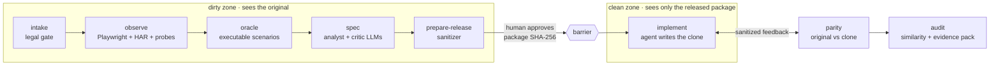

| Phase | Zone | What happens |
|---|---|---|
| **intake** | dirty | Project card with lawful-access attestation, allowed domains, brand terms and a new product name. |
| **observe** | dirty | Headless Chromium crawls the target and records a HAR. On a sandbox target it also submits forms, clicks controls and probes the API for validation rules. Rate-limited to 2 req/s. |
| **oracle** | dirty | Recorded traffic becomes replayable scenarios (status, response shape, pinned values, multi-step chains). Scenarios that do not reproduce on a reset original are dropped. |
| **spec** | dirty | An analyst LLM writes a behavioral spec in its own words; a critic LLM reviews it. API contracts are derived deterministically, not by the LLM. |
| **prepare-release** | dirty → draft | The sanitizer removes code, verbatim text (8-token shingles against everything seen from the original), brand names and domains. |
| **approve / release** | released | An operator or the customer's analyst approves the draft by its package SHA-256. Change anything and the hash no longer matches. |
| **implement** | clean | A planner + executor loop writes the clone in a workspace outside the project and iterates until the released scenarios pass. |
| **parity** | verifier | The original runs the full scenarios, the clone runs the released projection. Only short, sanitized feedback goes back to the clean zone. |
| **audit** | verifier | Code-similarity check against the original's JS/CSS, brand scan, and a zip evidence pack with the ledger, approvals and reports. |

## Screenshots

The operator console (`reverseai console`) — minimal, dark and light themes, works at phone width.

<table>
<tr>
<td width="50%">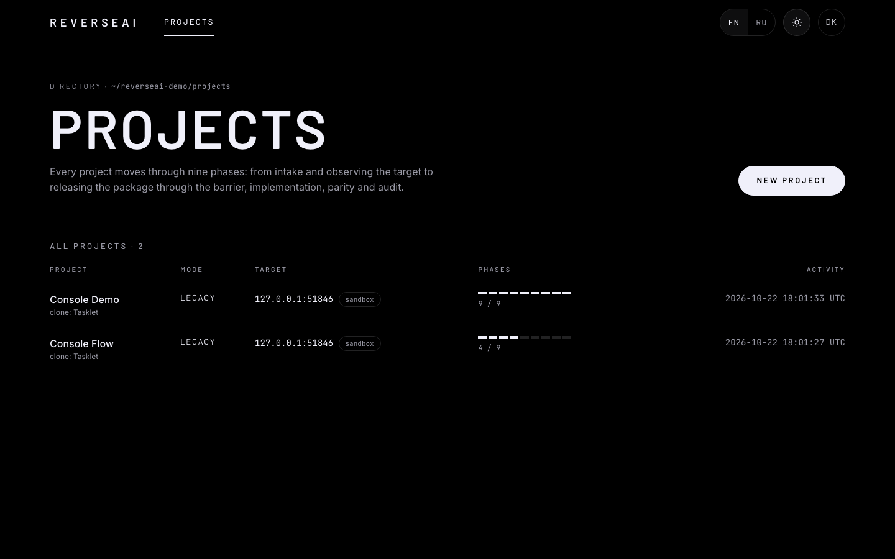<br><sub><b>Projects</b> — every project and its 9-phase progress</sub></td>
<td width="50%">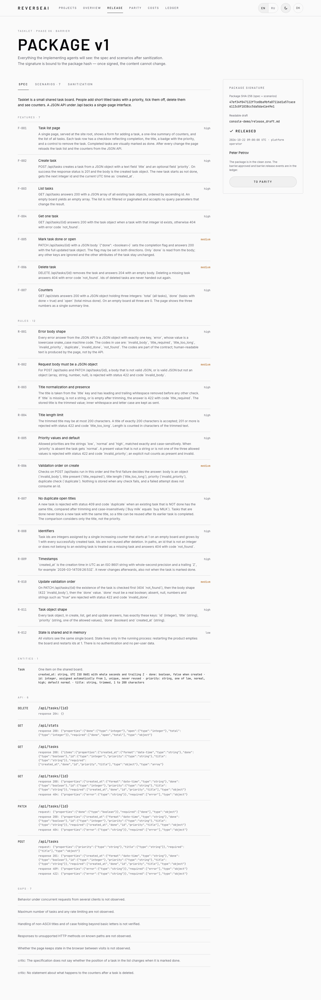<br><sub><b>Release review</b> — spec, scenarios, sanitizer report; approval bound to the package hash</sub></td>
</tr>
<tr>
<td width="50%">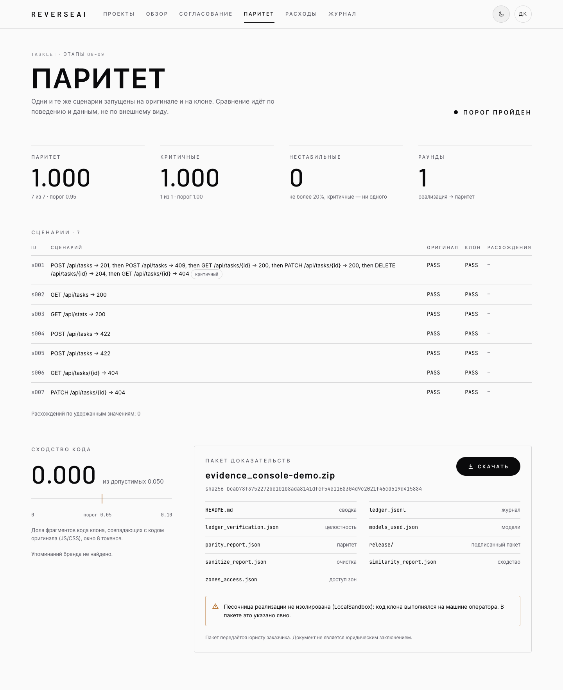<br><sub><b>Parity & evidence</b> — original vs clone per scenario, code similarity, evidence pack</sub></td>
<td width="50%">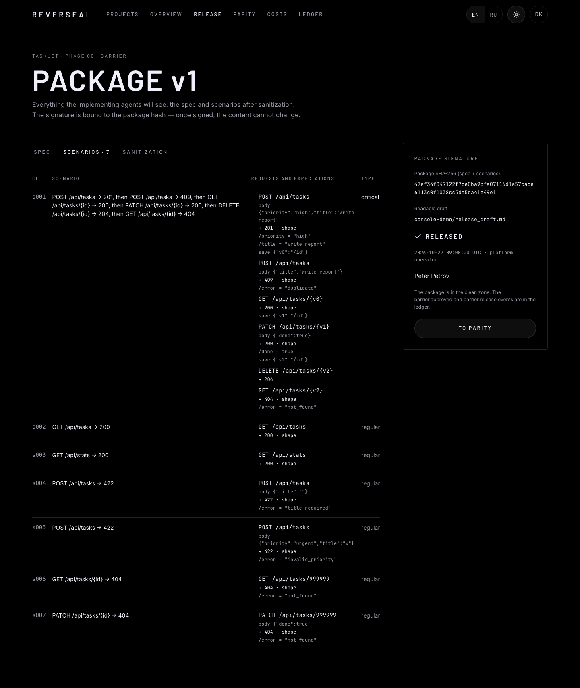<br><sub><b>Scenarios</b> — exactly what the clean zone will receive</sub></td>
</tr>
<tr>
<td width="50%">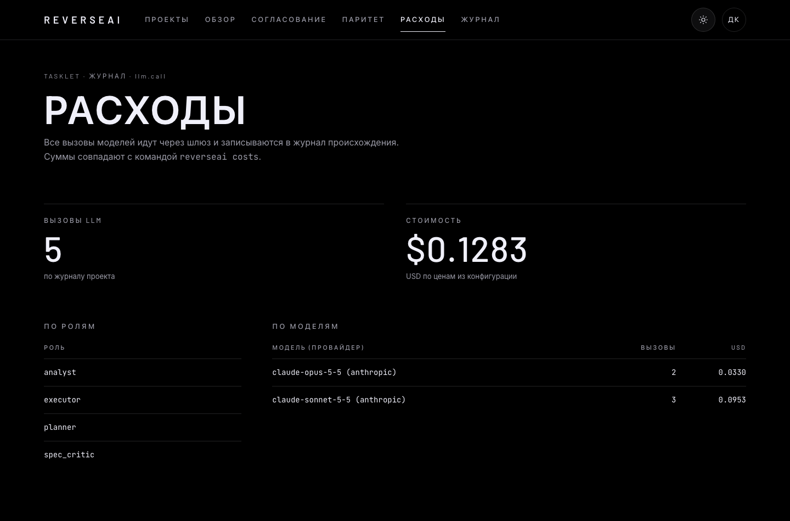<br><sub><b>Costs</b> — LLM spend by role and model, from the ledger</sub></td>
<td width="50%">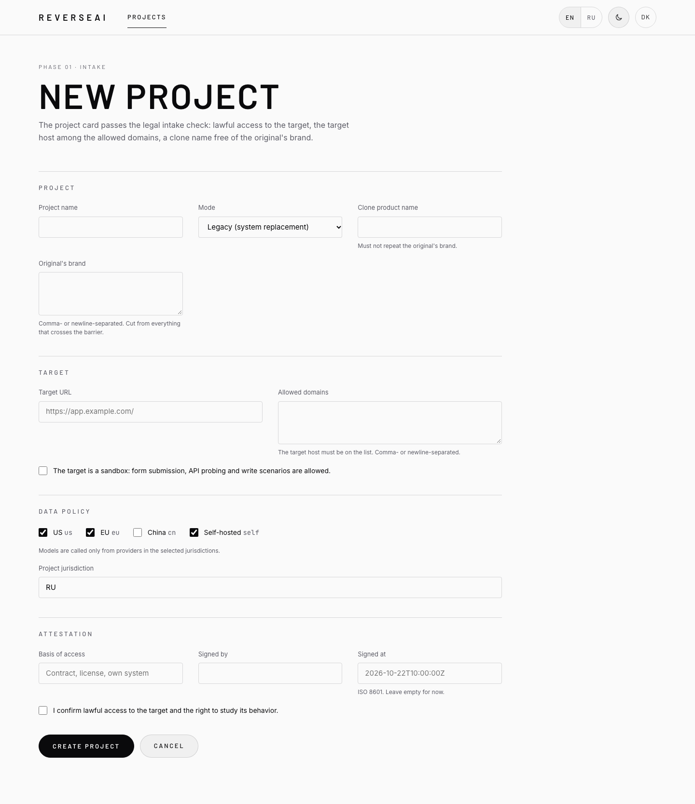<br><sub><b>New project</b> — the same legal gate as the CLI</sub></td>
</tr>
</table>

<p align="center">
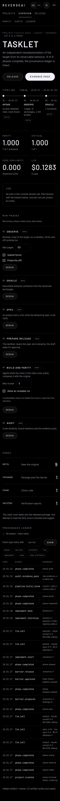
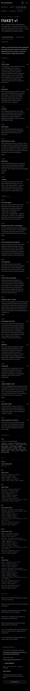
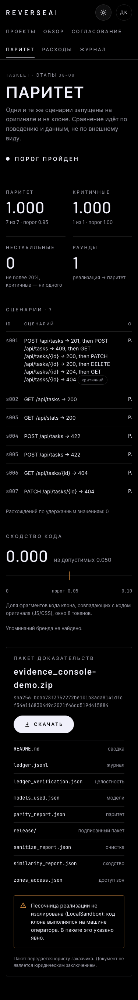
</p>

All 23 screens in both themes: [`docs/console-screenshots/`](docs/console-screenshots/) (the Russian interface: [`docs/console-screenshots/ru/`](docs/console-screenshots/ru/)).

The interface — CLI output, console, job logs, release draft, evidence pack README — is English by default, with Russian available: `--lang ru` (or `REVERSEAI_LANG=ru`) for the CLI, the EN/RU switch in the console header (remembered in a cookie), or `reverseai console --lang ru` for the console's default.

## Clean-room guarantees, in code

- **Zones enforced by the artifact store.** `ArtifactStore.get` refuses any dirty artifact to a clean-zone reader and logs the attempt. The implementation agent reads exactly one artifact: the released package.
- **One sanitizing rule everywhere.** Prose goes through full sanitizing; identifiers (paths, field names, ids) only through brand/domain masking, consistently across bodies, schemas and pointers. Brand matching is case-insensitive and catches glued identifiers (`acme_id`, `AcmeTasks`, `task-board`).
- **Approval bound to a hash.** The human signs the SHA-256 of spec + scenarios. Re-running any earlier phase invalidates everything after it.
- **Hash-chained ledger.** Every LLM call, artifact read/write, approval, release and phase transition is appended with file locking, so the CLI and the console can share one chain.
- **No secrets anywhere.** API keys come from environment variables and never reach the ledger, artifacts, prompts or the sandbox environment.
- **No harm to the target.** Writes (form submits, probing, write scenarios in parity) happen only on targets marked as sandboxes.

## Quick start

Requires Python 3.12 and [uv](https://docs.astral.sh/uv/).

```bash
git clone https://github.com/drkokorev/ReverseAI.git
cd ReverseAI
uv sync
uv run playwright install chromium

uv run pytest                          # unit + integration tests (browser/docker tests skip if unavailable)
uv run pytest -m browser tests/e2e     # the whole pipeline on the bundled demo target, LLM scripted
```

Run the console on the projects from a benchmark run, or create a project from the UI:

```bash
uv run reverseai console --projects-root projects/   # http://127.0.0.1:8765
uv run reverseai console --projects-root projects/ --lang ru   # Russian by default
```

With real model keys, run the full pipeline on the bundled demo target and get parity, hidden-test, similarity and cost metrics:

```bash
export ANTHROPIC_API_KEY=...            # or OPENAI_API_KEY / DEEPSEEK_API_KEY / ZAI_API_KEY
uv run reverseai bench --target taskboard --live
```

## Using it on a project (CLI)

```bash
uv run reverseai init --card card.yaml --projects-root projects   # legal gate
P=projects/acme-orders
uv run reverseai observe --project $P --max-pages 50
uv run reverseai oracle --project $P
uv run reverseai spec --project $P
uv run reverseai prepare-release --project $P                     # prints the package SHA-256
uv run reverseai approve --project $P --approver "Jane Doe" --role customer_analyst --sha <sha256>
uv run reverseai build --project $P --max-rounds 3                # exit code 2 if parity is below threshold
uv run reverseai audit --project $P --out evidence/               # exit code 2 if similarity/brand check fails
uv run reverseai status --project $P                              # also: costs, ledger-verify
```

A minimal `card.yaml`:

```yaml
name: Acme Orders
mode: legacy                      # legacy | import_substitution
target_base_url: https://orders.acme.example/
allowed_domains: [orders.acme.example]
target_is_sandbox: false          # true only for a test stand: enables writes and API probing
attestation:
  lawful_access: true
  basis: "Contract #42, clause 5: right to analyze and reimplement"
  signed_by: "Customer counsel"
  signed_at: "2026-10-20T10:00:00+00:00"
brand_terms: [Acme Orders, Acme]
product_name: OrderFlow           # the clone's name; must not reuse brand terms
target_stack: python-fastapi
```

### Model providers

Role-based routing (`planner`, `judge`, `spec_critic`, `analyst`, `executor`, `bulk`) with retries, fallbacks, a per-project data policy and cost accounting lives in [`src/reverseai/config/default.yaml`](src/reverseai/config/default.yaml). Supported out of the box: Anthropic, OpenAI and Anthropic-compatible endpoints (DeepSeek, Z.ai). Chinese providers are disabled by the default data policy (`us`, `eu`, `self`) and can be enabled per project.

## Architecture

```
src/reverseai/
├── provenance/   hash-chained ledger (ledger.jsonl + cross-process lock)
├── zones/        Zone enum and ArtifactStore (read rules enforced in get)
├── llm/          Gateway: role routing, data policy, retry/fallback, cost; providers; JSON helper
├── sandbox/      LocalSandbox (not isolated) and DockerSandbox (no network)
├── project.py    project card, legal gate, project lock
├── observe/      Playwright explorer, HAR parsing, API probe, endpoint contracts
├── oracle/       behavior scenarios; standalone.py runner (stdlib + httpx only)
├── spec/         behavioral spec model, analyst + critic builder, renderer
├── barrier/      sanitizer and release gate
├── implement/    clone agent loop, workspace rules, clone templates
├── parity/       differential run and sanitized feedback
├── audit/        code similarity and evidence pack
├── pipeline.py   phase state machine
├── cli.py        `reverseai` CLI
├── console/      FastAPI + Jinja web console
└── bench/        benchmark harness and in-process demo target
```

Design decisions are logged in [`docs/spec/decisions.md`](docs/spec/decisions.md); the product spec is [`docs/spec/spec.md`](docs/spec/spec.md); the implementation plan, the console design and the audit reports are in [`docs/superpowers/`](docs/superpowers/). The background research (tools landscape, papers, model pricing, legal and market notes) is in [`docs/research/`](docs/research/) (Russian).

## Limitations

- Only web targets and only a Python/FastAPI clone template.
- Clone code runs in `LocalSandbox`, which does **not** isolate it from your machine; `DockerSandbox` exists but is not wired into the CLI or console. Do not point it at real targets without isolation.
- No login flows on targets, no non-browser traffic capture.
- Thresholds (95% parity, 100% critical scenarios, 5% code similarity) are working values, not validated ones.
- Single-operator console: no accounts, jobs live in process memory.
- Tested end to end only on the bundled demo target with a scripted LLM.

## Status and help wanted

This is a prototype, published so the ideas and the code can be reused. I am not developing it further — **fork it, take pieces of it, or pick up one of the open problems below**. Pull requests are welcome too; see [CONTRIBUTING.md](CONTRIBUTING.md).

What would move it forward the most:

1. **A live run.** Run `reverseai bench --target taskboard --live` with real models and publish parity, cost and the number of build rounds per model. Nobody has done it yet.
2. **Isolation.** Wire `DockerSandbox` into `build`, `bench` and the console, with a prebuilt image (fastapi, uvicorn, httpx).
3. **A real open-source target.** Point the pipeline at a small self-hosted app (a todo app, a pastebin, a URL shortener) and report what breaks.
4. **Login flows.** Let the observer sign in to a sandbox target with a test account.
5. **A second clone template.** TypeScript / Next.js next to `python-fastapi` (see D-006).
6. **Cheaper models.** Compare model mixes per role by cost per solved scenario (OpenRouter, DeepSeek, local open-weights models).
7. **Durable jobs.** Console jobs survive a restart; multi-user access.

## Responsible use

ReverseAI is meant for legitimate clean-room work: modernizing systems you own, interoperability, migrating off lock-in where the law allows it. Observing a product you have lawful access to and reimplementing its functionality is treated very differently across jurisdictions, and a clean-room process does **not** protect against patents, trademarks or trade dress. Nothing in this repository is legal advice.

## License

[MIT](LICENSE) © 2026 drkokorev
